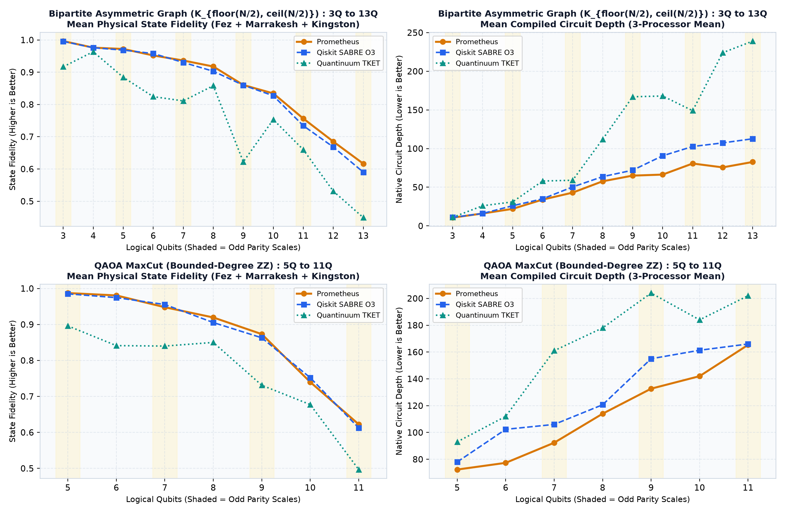
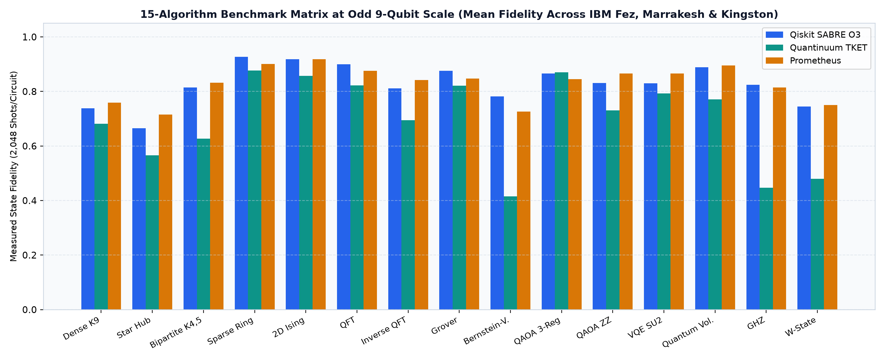

# Comparing Quantum Compilation Strategies on IBM Hardware

*Explore the portfolio: [Prometheus Quantum Overview](https://github.com/PrometheusDynamicsCanada/prometheus-quantum-overview)*

**The same logical calculation can produce different physical circuits - and different results. This study compares compilation strategies on real IBM hardware.**

To prevent hourly hardware drift from skewing results, every calculation ran Qiskit SABRE, Quantinuum TKET, and Prometheus inside the same batch execution window across odd and even circuit sizes (`3` to `13` qubits) on three IBM processors.

Across **99 three-way comparisons**, Prometheus produced closer agreement with the ideal answer than SABRE in **`65/99` (`65.7%`)** runs and TKET in **`89/99` (`89.9%`)**, and won **`16/18`** configurations in a separate pre-committed suite (`6/6` at `12` qubits). SABRE still won **`32/99`** and TKET **`5/99`** individual runs on shallow circuit families, showing why Prometheus evaluates candidates alongside existing compilers rather than replacing them.

**[Detailed results](DETAILED_TECHNICAL_REPORT.md) · [Verify the evidence](#verify-the-evidence) · [Discuss a pilot](#discuss-a-pilot)**


*Opening summary (`Experiment 1` across `ibm_fez`, `ibm_marrakesh`, and `ibm_kingston`): Output-distribution agreement (`0` to `1`, higher is closer to the ideal answer) across odd and even widths from `3` to `13` qubits (`54` same-window 3-way comparisons, `162` circuits).*

---

## 1. Executive Summary & Principal Comparative Tables

*Campaign Scope:* `10` batch `SamplerV2` jobs (`6` tournament jobs + `4` pre-committed validation jobs), `441` physical circuits, and `755,712` physical shots across 156-qubit `ibm_fez`, `ibm_marrakesh`, and `ibm_kingston`.

> [!NOTE]
> **Metric & Direction Conventions:**
> - **Classical Distribution Overlap (F_B, ↑ higher is better):** Used in Experiments 1 and 2 (`fidelity` in [`data/heron_156q_99tournaments_297circuits.csv`](data/heron_156q_99tournaments_297circuits.csv)), defined as F_B(P_ideal, P_meas) = Σ_x √(P_ideal(x) · P_meas(x)).
> - **Squared Hellinger Fidelity (F_H = F_B², ↑ higher is better):** Used in Experiment 3 (`squared_hellinger_fidelity` in [`validation_suite_144_executions/`](validation_suite_144_executions/)). Both evaluate computational-basis measurement distributions from shot counts and are distinct from 4ⁿ state tomography.
> - **Total Variation Distance (TVD, ↓ lower is better):** 0.5 · Σ_x |P_ideal(x) - P_meas(x)|.
> - **Heavy-Output Probability (HOP, ↑ higher is better):** Measured probability mass on bitstrings exceeding the median of P_ideal(x).
> - **Bold values** indicate the winning compiler in each row.

### Table 1A: Experiments 1 & 2 - Pairwise Win Rates, 3-Way Tournament Wins & Fidelity Summary (99 Tournaments / 297 Circuits)

| Campaign / Benchmark Subset | Hardware Jobs (Circuits / Shots) | Depth ≤ SABRE (↓) | Pairwise F_B ≥ SABRE (↑) | Pairwise F_B ≥ TKET (↑) | 3-Way Tournament Wins (Beats Both ↑) | Mean Fidelity F_B *(mean)* (SABRE / TKET / Prom ↑) | Mean 2Q CZ *(mean)* (S / T / Prom ↓) | Mean Depth *(mean)* (S / T / Prom ↓) |
| :--- | :---: | :---: | :---: | :---: | :---: | :---: | :---: | :---: |
| **Exp 1: Odd/Even Scale Sweep (3Q-13Q)** | 3 jobs (162 circs / 331,776 shots) | **54 / 54 (100.0%)** | **38 / 54 (70.4%)** | **49 / 54 (90.7%)** | **35 / 54 (64.8%)** | 0.8588 / 0.7559 / **0.8652** | 43.67 / 73.11 / **38.69** | 87.59 / 132.11 / **74.98** |
| **Exp 1: Odd Scales (3, 5, 7, 9, 11, 13Q)** | 3 jobs (90 circs / 184,320 shots) | **30 / 30 (100.0%)** | **22 / 30 (73.3%)** | **27 / 30 (90.0%)** | **20 / 30 (66.7%)** | 0.8494 / 0.7307 / **0.8568** | 45.27 / 77.73 / **40.20** | 89.20 / 135.43 / **75.90** |
| **Exp 1: Even Scales (4, 6, 8, 10, 12Q)** | 3 jobs (72 circs / 147,456 shots) | **24 / 24 (100.0%)** | **16 / 24 (66.7%)** | **22 / 24 (91.7%)** | **15 / 24 (62.5%)** | 0.8705 / 0.7873 / **0.8756** | 41.67 / 67.33 / **36.79** | 85.58 / 127.96 / **73.83** |
| **Exp 2: 15-Algorithm Matrix (9Q Odd)** | 3 jobs (135 circs / 276,480 shots) | 30 / 45 (66.7%) | **27 / 45 (60.0%)** | **40 / 45 (88.9%)** | **27 / 45 (60.0%)** | 0.8278 / 0.6969 / **0.8304** | 45.00 / 60.87 / **44.29** | **105.98** / 148.33 / 107.09 |
| **Combined Exp 1 + 2 (99 Tournaments)** | **6 jobs (297 circs / 608,256 shots)** | **84 / 99 (84.8%)** | **65 / 99 (65.7%)** | **89 / 99 (89.9%)** | **62 / 99 (62.6%)** | 0.8447 / 0.7291 / **0.8494** | 44.27 / 67.55 / **41.23** | 95.95 / 139.48 / **89.58** |

### Table 1B: Experiment 3 - Pre-Committed 144-Execution Multi-QPU Validation Suite ([`validation_suite_144_executions/`](validation_suite_144_executions/))

| Pre-Committed Suite Cohort | Hardware Jobs (Circuits / Shots) | Prometheus Depth ≤ SABRE (↓) | Primary Metric Wins vs. SABRE O3 (↑) | Primary Metric Wins vs. TKET (↑) | Multi-QPU Dispatch Scope & Outcome |
| :--- | :---: | :---: | :---: | :---: | :--- |
| **All 18 Primary Instances (6Q, 9Q, 12Q on `ibm_marrakesh`)** | 2 jobs (108 circs / 110,592 shots) | **14 / 18 (77.8%)** | **16 / 18 (88.9%)** | **15 / 18 (83.3%)** | Primary Slot A baseline (`ibm_marrakesh`, 2 blocks × 1,024 shots) |
| **12-Qubit Scale Cohort (6 Workloads on `ibm_marrakesh`)** | 2 jobs (36 circs / 36,864 shots) | **6 / 6 (100.0%)** | **6 / 6 (100.0%)** | **6 / 6 (100.0%)** | Primary Slot A 12Q cohort (**100% Prometheus win rate**) |
| **9-Qubit Multi-QPU Broadcast (`ibm_marrakesh`, `ibm_fez`, `ibm_kingston`)** | 3 jobs (54 circs / 55,296 shots) | **4 / 6 (66.7%)** | **5 / 6 (83.3%)** *(Slot A)* | **4 / 6 (66.7%)** *(Slot A)* | **6 / 6 (100.0%)** vs. `ibm_marrakesh` & `ibm_fez`; **5 / 6 (83.3%)** vs. `ibm_kingston` |
| **Complete Pre-Committed Campaign (Slots A + B + C)** | **4 jobs (144 circs / 147,456 shots)** | **14 / 18 (77.8%)** | **16 / 18 (88.9%)** | **15 / 18 (83.3%)** | **6 / 6** vs. Fixed A/B (**5 / 6** vs. Fixed C) |



*Supporting Figure: 15-Algorithm Benchmark Matrix at Odd 9-Qubit Scale (N = 45 3-way tournaments / 135 physical circuits, 2,048 shots/circuit = 276,480 shots across `ibm_fez`, `ibm_marrakesh`, and `ibm_kingston`; source: [`data/heron_156q_99tournaments_297circuits.csv`](data/heron_156q_99tournaments_297circuits.csv)).*

---

## 2. Workload-Family Wins & Losses Summary (`99` Same-Window 3-Way Runs)

In the `9Q` 15-algorithm matrix (`45` three-way runs across 3 Heron chips; full per-algorithm table in [`DETAILED_TECHNICAL_REPORT.md`](DETAILED_TECHNICAL_REPORT.md)), Prometheus led on non-local/structured families such as Quantum Fourier Transform, Grover Search, VQE (`SU2`), Quantum Volume, and Bipartite routing (`27/45` vs. SABRE, `40/45` vs. TKET), whereas Qiskit SABRE O3 led on shallow bounded-ZZ QAOA (`0.8634` vs. `0.8259`), GHZ cascades (`0.7256` vs. `0.7114`), and W-State cascades (`0.6096` vs. `0.6052`). All `10` IBM Job IDs (`dbc9olfi0auc73dug6ig` through `dbgjtecdgr2s73crlre0`) are listed in [`DETAILED_TECHNICAL_REPORT.md`](DETAILED_TECHNICAL_REPORT.md).

---

## Verify the Evidence

**Verification Kind:** Combines **outcome-ledger consistency & statistical verification** on the `297`-circuit tournament CSV (`scripts/verify_ledger.py`) with **direct raw bitstring-payload scoring** on the `144`-execution pre-committed validation suite (`validation_suite_144_executions/check_scoring.py`, cross-referenced and counted once in portfolio accounting):

```bash
python scripts/verify_ledger.py
python validation_suite_144_executions/check_scoring.py
```

- **Key files:** [`DETAILED_TECHNICAL_REPORT.md`](DETAILED_TECHNICAL_REPORT.md) · [`data/heron_156q_99tournaments_297circuits.csv`](data/heron_156q_99tournaments_297circuits.csv) · [`validation_suite_144_executions/`](validation_suite_144_executions/) · [`PUBLIC_DISCLOSURE.md`](PUBLIC_DISCLOSURE.md)

---

## Discuss a Pilot

**Bring a representative workload and an acceptance criterion. We can compare Prometheus with your existing execution approach and measure quality, acceptance rate and charged hardware resources.**

- **Contact:** [william@prometheusdynamics.ca](mailto:william@prometheusdynamics.ca) | [prometheusdynamics.ca](https://prometheusdynamics.ca)
